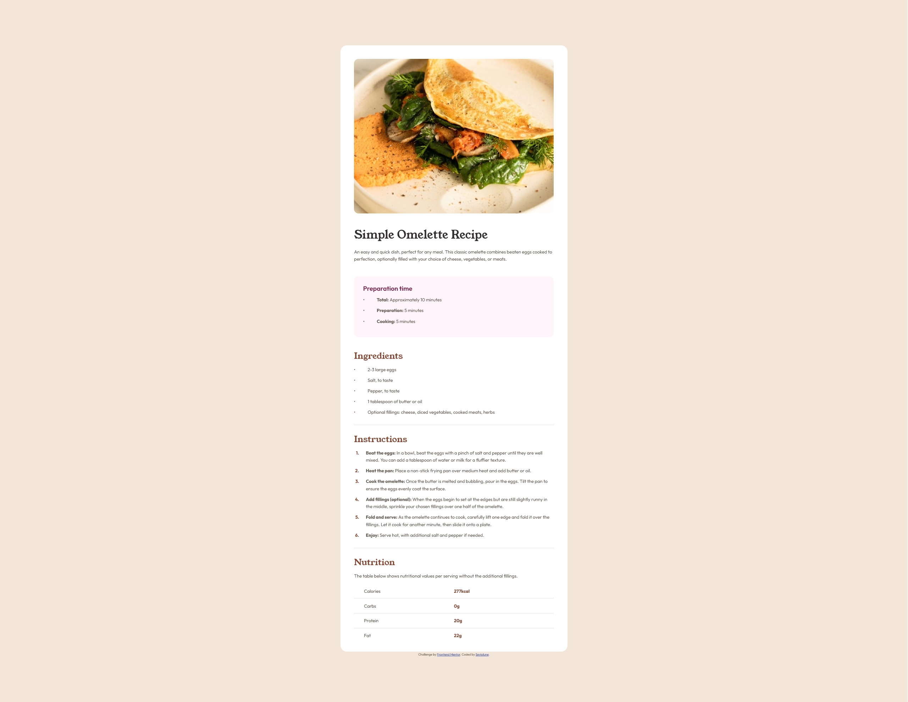

# Frontend Mentor - Recipe page solution

This is a solution to the [Recipe page challenge on Frontend Mentor](https://www.frontendmentor.io/challenges/recipe-page-KiTsR8QQKm).

## Overview

### Screenshot

### Links

- Github repository URL: [https://github.com/Seviolune/recipe-page-main](https://github.com/Seviolune/recipe-page-main)
- Solution URL: [not uploaded yet](https://www.frontendmentor.io/challenges/social-links-profile-UG32l9m6dQ)
- Live Site URL: [https://seviolune.github.io/recipe-page-main](https://seviolune.github.io/recipe-page-main)

## Author

- Github: [Seviolune](https://github.com/Seviolune)
- Frontend Mentor: [@Seviolune](https://www.frontendmentor.io/profile/seviolune)